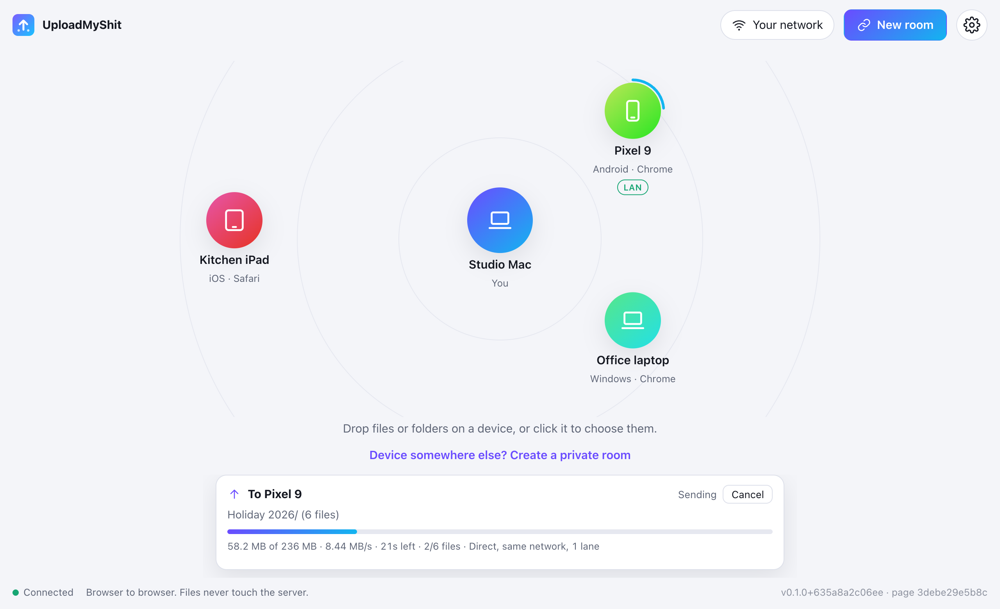

<p align="center">
  
</p>

<h1 align="center">UploadMyShit</h1>

<p align="center">
  <strong>Send files and whole folders from one browser to another.</strong><br>
  Peer to peer, straight to disk, no account, nothing stored on a server.
</p>

<p align="center">
  <a href="#quick-start">Quick start</a> ·
  <a href="docs/deployment.md">Deploy</a> ·
  <a href="docs/architecture.md">How it works</a> ·
  <a href="docs/troubleshooting.md">Troubleshooting</a>
</p>

<p align="center">
  
</p>

UploadMyShit is a self-hosted replacement for ShareDrop. Open the page on two devices, drop
files or folders on the other device, and the bytes go browser to browser over WebRTC. The
server only introduces the devices to each other. In Chrome, the receiver picks a folder
once and every file streams into it, each one complete the moment its last byte lands.

## Features

- **Peer to peer.** File data goes browser to browser over encrypted WebRTC data channels.
  The server relays a few KB of connection setup per transfer and never sees file
  contents.
- **Many files and folders at once.** Drop any mix of files and folders on a device, or
  click it to pick some. Folder structure is kept, empty folders included.
- **Straight to disk (Chrome).** The receiver chooses a destination folder once, and
  Chrome remembers it. Files are written in place as they arrive, nothing waits for the
  whole batch, and nothing is held in memory. Existing files are never overwritten: a
  clash becomes `name (2)`.
- **Fast by default.** Disk reads run ahead in parallel and writes are merged in a Web
  Worker. Large transfers add WebRTC connections while each one still raises the rate.
  The receiver grants a credit window, so a slow disk throttles the sender instead of
  filling memory. An optional upload cap applies to all transfers.
- **Works across networks.** Devices behind the same public address find each other on
  their own. A private room, shared as a link or a QR code, connects devices anywhere.
- **A relay for when direct fails, and for speed.** Devices that can't connect directly
  fall back to a small Cloudflare Worker you deploy, within about 4 seconds. Large
  transfers can also add relay lanes beside a direct connection when that's faster. Relay
  data is end-to-end encrypted, so the Worker passes bytes it can't read. TURN is
  supported too.
- **Recovers on its own.** A connection that dies mid-transfer, or a relay lane that stops
  delivering, is dropped. The receiver asks again for exactly the chunks it lost.
- **Leaves OS clutter behind.** `Thumbs.db`, `desktop.ini`, `.DS_Store`, `._` files,
  Office lock files, `$RECYCLE.BIN`, `__MACOSX` and the like are never sent. Names the
  receiving system can't store are cleaned, using the rules Chrome itself applies.
- **Diagnostics built in.** Settings → Diagnostics shows how each connection travels and
  why, measures lanes and rates live, and runs a network test.

## Quick start

```sh
cargo run
# then open http://localhost:8080 in two browser windows
```

Or with Docker:

```sh
docker build -t uploadmyshit .
docker run -p 8080:8080 uploadmyshit
```

Browsers only allow WebRTC and folder access on secure pages. `localhost` counts as
secure; a LAN address over plain HTTP doesn't. To try it across devices, put it behind
TLS. The [Helm chart](charts/uploadmyshit)'s ingress does that.

## Browsers

**Chrome on a computer is the supported browser.** It is the only one with the File System
Access API that lets the receiver stream into a folder. Every browser with WebRTC can
send.

Browsers without folder access can still receive: Chrome on Android, anything on iOS,
Firefox and Safari. There, each file downloads as soon as it is complete. Folder structure
is lost, because each download is a single file.

## How it works

```
 Browser A ──── WebSocket (signaling: who's here, SDP, ICE, relay tickets) ───┐
     │                                                                        ▼
     │                                                  uploadmyshit (Rust, axum)
     │                                                  rooms in memory, no storage
 Browser B ──── WebSocket ────────────────────────────────────────────────────┘
     ▲
     ├──── WebRTC data channels, DTLS-encrypted, direct ──────────── Browser A
     │
     └──── WebSockets ── relay Worker (Cloudflare) ── WebSockets ─── Browser A
           end-to-end encrypted; when there is no direct path, or beside one when faster
```

- **The server** ([src/](src/)) serves the page, which is compiled into the binary, and
  one WebSocket. It keeps rooms in memory, passes connection setup between devices in the
  same room, hands out STUN/TURN servers and signs relay tickets.
- **The page** ([web/](web/)) is hand-written HTML, CSS and JavaScript modules, with no
  build step and no dependencies. It negotiates the connections, runs the transfer
  protocol and writes to disk.
- **The relay** ([worker/](worker/)) is a Cloudflare Worker with one Durable Object per
  relay session and lane. It pairs two WebSockets and passes frames between them.

[docs/architecture.md](docs/architecture.md) covers each part and the decisions behind it.
[docs/protocol.md](docs/protocol.md) is the wire reference.

## Performance

Chrome's WebRTC data channels set the ceiling, not this code. Each ~1.2 KB packet crosses
from the page's process to Chrome's network process separately. Chromium has a batched
path, but it is switched off. No published browser-to-browser measurement in Chrome
exceeds about 45 MB/s.

Measured with two Chrome processes on one Apple Silicon Mac, streaming into a folder:

| Setup | Throughput |
| --- | --- |
| Raw data channel, 1 connection (no app) | 37 MB/s (296 Mbps) |
| UploadMyShit, 1 connection | 31–45 MB/s (248–360 Mbps) |
| UploadMyShit, 4 connections | 36–42 MB/s (288–336 Mbps) |

The relay doesn't share that ceiling, because it is plain WebSockets over TCP. Two
browsers on one machine relaying through a deployed Worker in a nearby Cloudflare
location measured 0.8–1.05 Gbps on one lane and about 2.2 Gbps on three. That is a best
case: real devices are limited by their own connection and their distance to the Worker.
For comparison, Cloudflare's TURN service varied between 0.6 and 85 Mbps from one
connection to the next.

## Deploying

The server is a single static binary with no storage. It runs as **one replica**, because
rooms live in memory. That is plenty: it carries signaling only.

| | |
| --- | --- |
| [docs/deployment.md](docs/deployment.md) | Docker, Kubernetes, reverse proxies and Cloudflare, the relay, TURN, CI/CD, and a post-deploy checklist |
| [charts/uploadmyshit](charts/uploadmyshit) | The Helm chart and every value it takes |
| [worker/](worker/) | The relay Worker: deploying it and how it works |
| [docs/configuration.md](docs/configuration.md) | Every server flag and environment variable |

**Behind a reverse proxy, network rooms need each visitor's real address.** If every
visitor appears to come from one address, strangers end up in one room. Behind
Cloudflare, set `UMS_CLIENT_IP_HEADER=cf-connecting-ip`. See
[Visitor addresses](docs/deployment.md#visitor-addresses-and-network-rooms).

## Documentation

| Document | What's in it |
| --- | --- |
| [Architecture](docs/architecture.md) | The server, the page, connections, the transfer protocol, receiving, updates |
| [Protocol](docs/protocol.md) | Signaling messages, relay tickets and frames, transfer frames and control messages |
| [Deployment](docs/deployment.md) | Running it in production, behind proxies and Cloudflare |
| [Configuration](docs/configuration.md) | Server flags and environment variables |
| [Troubleshooting](docs/troubleshooting.md) | Symptoms, causes and fixes |
| [Security](docs/security.md) | What the server, the relay and other people can and cannot see or do |
| [Development](docs/development.md) | Code layout, tests, and how to measure what Chrome does |

## Development

```sh
cargo fmt --check && cargo clippy --all-targets -- -D warnings && cargo test
node --test 'tests/web/*.test.mjs'
cargo build && (cd worker && npm ci) && (cd tests/e2e && npm ci && node transfer.mjs)
```

The last line runs two real Chrome processes against the server and a local relay. Its
scenarios cover folders, every fallback, lost lanes, real folders dropped from disk, and
tabs left open across a deploy. [docs/development.md](docs/development.md) has the rest.

## Security

Every transfer needs the receiver's consent. Incoming paths can't escape the chosen
folder. Relay traffic is end-to-end encrypted. The page loads nothing from other sites,
and the server never sees file contents. [docs/security.md](docs/security.md) has the
details and the known gap.

## Roadmap

- Resume an interrupted transfer, using the per-chunk tracking that already exists.
- Move receiving into a Worker with transferable `RTCDataChannel` (Chrome 130+).
- A short verification code from both ends' keys (DTLS and relay), to detect a man in the
  middle.
- Several replicas, with rooms in a shared store.

## License

MIT. See [LICENSE](LICENSE).
